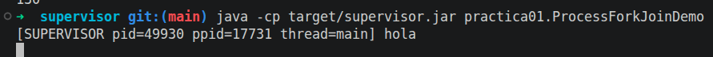
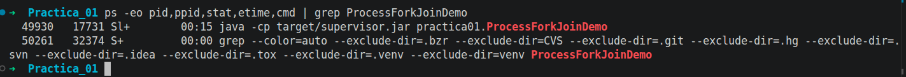
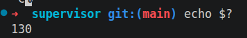

# Inventario de procesos

## Cómo se ha observado

El supervisor se lanza con una pausa temporal de 10 minutos (`Thread.sleep(600_000)`)
para que dé tiempo a observarlo desde otra terminal:

    # Terminal 1
    java -cp target/supervisor.jar practica01.ProcessForkJoinDemo

    # Terminal 2
    ps -eo pid,ppid,stat,etime,cmd | grep ProcessForkJoinDemo
    pstree -p 49930
    ps -T -p 49930

Se lanza con `-cp ... practica01.ProcessForkJoinDemo` en vez de `-jar` para
que el nombre de la clase aparezca en la línea de órdenes y `grep` lo encuentre.

## Salidas observadas

### Arranque del supervisor (terminal 1)

    $ java -cp target/supervisor.jar practica01.ProcessForkJoinDemo
    [SUPERVISOR pid=49930 ppid=17731 thread=main] hola

### `ps -eo pid,ppid,stat,etime,cmd | grep ProcessForkJoinDemo` (terminal 2)

      49930   17731 Sl+        00:15 java -cp target/supervisor.jar practica01.ProcessForkJoinDemo
      50261   32374 S+         00:00 grep --color=auto --exclude-dir=.bzr ... ProcessForkJoinDemo

### `pstree -p 49930`

    java(49930)─┬─{java}(49931)
                ├─{java}(49932)
                ├─{java}(49933)
                ├─{java}(49934)
                ├─{java}(49935)
                ├─{java}(49936)
                ├─{java}(49938)
                ├─{java}(49941)
                ├─{java}(49942)
                ├─{java}(49943)
                ├─{java}(49944)
                ├─{java}(49945)
                ├─{java}(49946)
                ├─{java}(49947)
                ├─{java}(49948)
                ├─{java}(49952)
                └─{java}(49953)

### `ps -T -p 49930`

        PID    SPID TTY          TIME CMD
      49930   49930 pts/1    00:00:00 java
      49930   49931 pts/1    00:00:00 java
      49930   49932 pts/1    00:00:00 GC Thread#0
      49930   49933 pts/1    00:00:00 G1 Main Marker
      49930   49934 pts/1    00:00:00 G1 Conc#0
      49930   49935 pts/1    00:00:00 G1 Refine#0
      49930   49936 pts/1    00:00:00 G1 Service
      49930   49938 pts/1    00:00:00 VM Periodic Tas
      49930   49941 pts/1    00:00:00 VM Thread
      49930   49942 pts/1    00:00:00 Reference Handl
      49930   49943 pts/1    00:00:00 Finalizer
      49930   49944 pts/1    00:00:00 Signal Dispatch
      49930   49945 pts/1    00:00:00 Service Thread
      49930   49946 pts/1    00:00:00 Monitor Deflati
      49930   49947 pts/1    00:00:00 C2 CompilerThre
      49930   49948 pts/1    00:00:00 C1 CompilerThre
      49930   49952 pts/1    00:00:00 Notification Th
      49930   49953 pts/1    00:00:00 Common-Cleaner

## Interpretación

**Estado `Sl+`** (ver `man ps`, sección *PROCESS STATE CODES*):

| Letra | Significado | Por qué aparece aquí |
|---|---|---|
| `S` | *Interruptible sleep*: el proceso espera un evento | El hilo principal está en `Thread.sleep` |
| `l` | Proceso multihilo | La JVM tiene 18 hilos |
| `+` | Pertenece al grupo de procesos en primer plano de la terminal | Se ha lanzado sin `&`; Ctrl+C le llega a él |

**PPID**: el PPID del supervisor (17731) es la `zsh` de la terminal 1, que es
quien lo ha lanzado. La línea extra del `grep` es el propio proceso `grep`
(su línea de órdenes contiene el texto `ProcessForkJoinDemo`). Tiene otro PPID
(32374) porque se ha lanzado desde la `zsh` de la terminal 2: cada terminal
es un proceso shell distinto.

    zsh (17731, terminal 1)          zsh (32374, terminal 2)
     └── java (49930) supervisor      └── grep (50261)

**Procesos e hilos**: `pstree` muestra **un solo proceso** `java(49930)`, y
entre llaves `{java}(…)` 17 **hilos** más. `ps -T` lo confirma: las 18 filas
tienen el **mismo PID (49930)** y cada una tiene un **SPID** (identificador de
hilo) diferente. El hilo con SPID = PID (49930) es el hilo inicial del
proceso.

Aunque el programa solo hace un `printf` y un `sleep`, la JVM crea sus propios
hilos internos:

| Hilos | Función |
|---|---|
| `GC Thread#0`, `G1 *` | Recolector de basura G1 |
| `C1/C2 CompilerThread` | Compilador JIT (traduce bytecode a código máquina) |
| `VM Thread`, `VM Periodic Task` | Operaciones internas de la JVM |
| `Signal Dispatcher` | Recibe las señales del sistema (por ejemplo, SIGINT de Ctrl+C) |
| `Finalizer`, `Reference Handler`, `Common-Cleaner` | Gestión de memoria y limpieza de objetos |

**Conclusión**: un proceso es una unidad con PID propio asignado por el
sistema operativo; los hilos son líneas de ejecución dentro de él y comparten
su PID. El hilo `main` de Java no es un proceso.

## Mapa de procesos

| Rol | PID | PPID | Estado observado | Código de retorno |
|---|---|---|---|---|
| Supervisor | 49930 | 17731 (zsh) | `Sl+` | 130 (interrumpido con Ctrl+C) |
| Worker Alpha | | | | |
| Worker Beta | | | | |
| Worker Gamma | | | | |

### Código de retorno

Se ha lanzado de nuevo el supervisor en la terminal 1, se ha parado con
Ctrl+C y, **en la misma terminal**, se ha consultado el código de retorno:

    $ java -cp target/supervisor.jar practica01.ProcessForkJoinDemo
    [SUPERVISOR pid=49930 ppid=17731 thread=main] hola
    ^C
    $ echo $?
    130

130 = 128 + 2, donde 2 es el número de la señal `SIGINT` (`kill -l`), que es
la que envía Ctrl+C. Ver [conceptos.md](conceptos.md#códigos-de-retorno-y-señales).

> Error detectado: un primer `echo $?` ejecutado en la terminal 2 devolvió
> `0`, pero era el código de retorno de la orden anterior de esa terminal
> (`ps -T`), no del supervisor. `$?` solo se refiere a la última orden de la
> misma shell.

## Portabilidad de las órdenes

| Orden | Linux | macOS | Windows | Notas |
|---|---|---|---|---|
| `ps -eo pid,ppid,stat,etime,cmd` | Sí | Parcial | No | `ps` es estándar POSIX, pero las columnas disponibles varían (en macOS es `command` en vez de `cmd`). |
| `pstree -p` | Sí, si está instalado el paquete `psmisc` | No viene por defecto | No | Herramienta auxiliar, no estándar. |
| `ps -T` | Sí | No | No | Opción específica de `procps` de Linux. |
| `echo $$`, `echo $?` | Sí | Sí | No (cmd/PowerShell usan otra sintaxis) | Variables de shells POSIX. |
| `ProcessHandle` (Java) | Sí | Sí | Sí | API de Java 9+, portable. |

Por eso la aplicación obtiene el PID, el PPID y los descendientes con
`ProcessHandle` y **no depende de `ps` ni de `pstree` para funcionar**: estas
órdenes solo se usan para observar y documentar.
