# Pruebas manuales

Ejecuciones hechas desde la terminal para comprobar cada rol por separado,
antes de que el supervisor los lance. Las pruebas automáticas (JUnit) están
en `src/test/java`.

## Paso 3 · Roles y códigos de retorno

Cada orden va seguida de `; echo $?` para ver el código de retorno en la
misma terminal.

| Orden (`java -cp target/supervisor.jar practica01.ProcessForkJoinDemo ...`) | Código esperado | Código obtenido |
|---|---|---|
| *(sin argumentos)* | 0 | 0 |
| `worker BETA 3 0` | 0 | 0 |
| `worker GAMMA 2 7` | 7 | 7 |
| `worker GAMMA 2 7 2>/dev/null` | 7 | 7 |
| `patata` | 2 | 2 |

Salida completa:

    $ java -cp target/supervisor.jar practica01.ProcessForkJoinDemo ; echo $?
    [SUPERVISOR pid=60358 ppid=17731 thread=main] hola, soc el supervisor
    0

    $ java -cp target/supervisor.jar practica01.ProcessForkJoinDemo worker BETA 3 0 ; echo $?
    [WORKER-BETA pid=60738 ppid=17731 thread=main] pas 1/3
    [WORKER-BETA pid=60738 ppid=17731 thread=main] pas 2/3
    [WORKER-BETA pid=60738 ppid=17731 thread=main] pas 3/3
    0

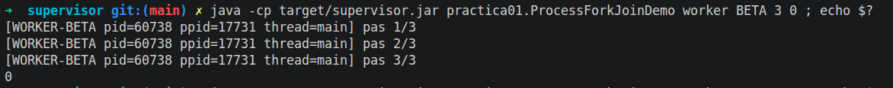

    $ java -cp target/supervisor.jar practica01.ProcessForkJoinDemo worker GAMMA 2 7 ; echo $?
    [WORKER-GAMMA pid=61135 ppid=17731 thread=main] pas 1/2
    [WORKER-GAMMA pid=61135 ppid=17731 thread=main] pas 2/2
    [WORKER-GAMMA pid=61135 ppid=17731 thread=main] acabo amb error, codi 7
    7

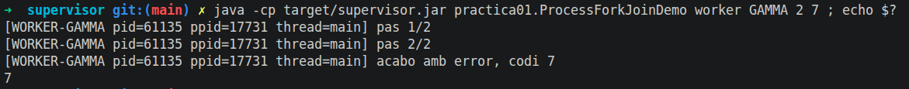

    $ java -cp target/supervisor.jar practica01.ProcessForkJoinDemo worker GAMMA 2 7 2>/dev/null ; echo $?
    [WORKER-GAMMA pid=61480 ppid=17731 thread=main] pas 1/2
    [WORKER-GAMMA pid=61480 ppid=17731 thread=main] pas 2/2
    7

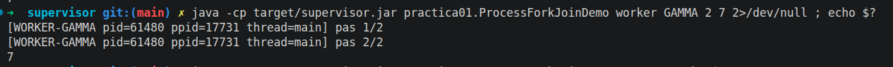

    $ java -cp target/supervisor.jar practica01.ProcessForkJoinDemo patata ; echo $?
    [SUPERVISOR pid=61835 ppid=17731 thread=main] rol desconegut: patata
    2

### Conclusiones

- **Cada ejecución es un proceso distinto** (PIDs 60358, 60738, 61135…) y
  todos tienen como padre la shell (PPID 17731), porque de momento se lanzan
  desde la terminal. Cuando el supervisor los lance, el PPID será el del
  supervisor.
- **El código de retorno llega al padre**: el worker GAMMA termina con
  `System.exit(7)` y la shell recibe un 7. Es la base de la actividad B: el
  supervisor tendrá que recoger este código y dejar el error explícito.
- **stdout y stderr son flujos separados**: con `2>/dev/null` se descarta
  stderr (descriptor 2) y desaparece solo la línea `acabo amb error`, que se
  escribe con `Log.error()` → `System.err`. Las líneas `pas i/N` (stdout,
  descriptor 1) se siguen viendo. Por eso el supervisor tendrá que leer los
  dos flujos por separado.
- Un rol desconocido no provoca una excepción: se informa por stderr y se
  devuelve el código 2.

## Paso 4 · El supervisor lanza un worker con `ProcessBuilder`

El supervisor construye la orden como **lista** y la ejecuta con
`ProcessBuilder.start()`. Con `inheritIO()` el hijo escribe directamente en la
misma terminal. Después espera con `waitFor()` y recoge el código de retorno.

    $ java -cp target/supervisor.jar practica01.ProcessForkJoinDemo ; echo $?
    [SUPERVISOR pid=99981 ppid=17731 thread=main] inici
    [SUPERVISOR pid=99981 ppid=17731 thread=main] llançant: [/usr/lib/jvm/java-21-openjdk-amd64/bin/java, -cp, target/supervisor.jar, practica01.ProcessForkJoinDemo, worker, BETA, 10, 0]
    [SUPERVISOR pid=99981 ppid=17731 thread=main] fill creat amb pid=100020
    [WORKER-BETA pid=100020 ppid=99981 thread=main] pas 1/10
    ...
    [WORKER-BETA pid=100020 ppid=99981 thread=main] pas 10/10
    [SUPERVISOR pid=99981 ppid=17731 thread=main] fill pid=100020 ha acabat amb codi 0
    0

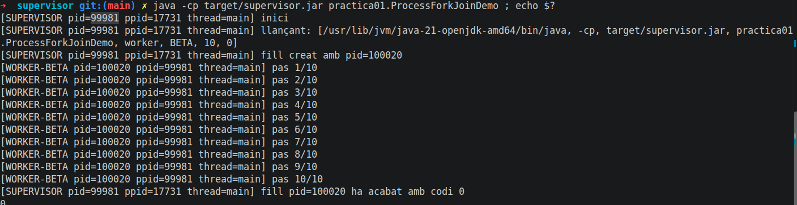

Árbol de procesos observado desde otra terminal mientras el worker trabajaba
(`pstree -p 99981`, resumido; `{java}` son hilos):

    java(99981)            SUPERVISOR
     ├── java(100020)      WORKER-BETA   (+ 17 hilos {java} propios)
     └── 19 hilos {java}   del supervisor

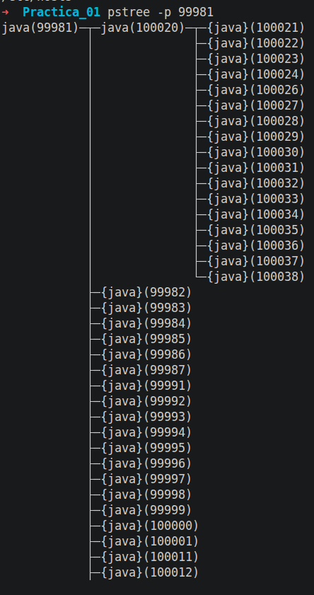

### Conclusiones

- El worker es un **proceso nuevo** (PID 100020) cuyo **PPID es el
  supervisor** (99981), no la shell. El supervisor sigue teniendo como padre
  la shell (17731):

      zsh (17731) → supervisor (99981) → worker BETA (100020)

- `pstree` muestra `java(100020)` **sin llaves**: es un proceso hijo, con sus
  propios hilos. Las entradas `{java}` son hilos.
- El código de retorno del worker (0) llega al supervisor con `waitFor()`, del
  mismo modo que a la shell con `echo $?`.
- Supervisor y worker escriben en la misma terminal porque, con
  `inheritIO()`, el hijo **hereda los descriptores 0, 1 y 2** del padre. Que
  compartan pantalla no los convierte en el mismo proceso.

## Paso 5 · Captura concurrente de stdout y stderr

Sin `inheritIO()`, los tubos del hijo se conectan al supervisor. Dos hilos del
supervisor (`io-stdout` e `io-stderr`, clase `LectorFlujo`) los leen **a la
vez** mientras el hijo trabaja. Cada línea se guarda con marca temporal y
origen, y se reemite por el stdout o el stderr del supervisor.

    $ java -cp target/supervisor.jar practica01.ProcessForkJoinDemo ; echo $?
    [SUPERVISOR pid=18816 ppid=5863 thread=main] inici
    [SUPERVISOR pid=18816 ppid=5863 thread=main] llançant: [/usr/lib/jvm/java-21-openjdk-amd64/bin/java, -cp, target/supervisor.jar, practica01.ProcessForkJoinDemo, worker, GAMMA, 3, 7]
    [SUPERVISOR pid=18816 ppid=5863 thread=main] fill creat amb pid=18837
    [SUPERVISOR pid=18816 ppid=5863 thread=io-stdout] 17:32:02.357 [stdout pid=18837] [WORKER-GAMMA pid=18837 ppid=18816 thread=main] pas 1/3
    [SUPERVISOR pid=18816 ppid=5863 thread=io-stdout] 17:32:03.349 [stdout pid=18837] [WORKER-GAMMA pid=18837 ppid=18816 thread=main] pas 2/3
    [SUPERVISOR pid=18816 ppid=5863 thread=io-stdout] 17:32:04.350 [stdout pid=18837] [WORKER-GAMMA pid=18837 ppid=18816 thread=main] pas 3/3
    [SUPERVISOR pid=18816 ppid=5863 thread=io-stderr] 17:32:05.358 [stderr pid=18837] [WORKER-GAMMA pid=18837 ppid=18816 thread=main] acabo amb error, codi 7
    [SUPERVISOR pid=18816 ppid=5863 thread=main] fill pid=18837 ha acabat amb codi 7 (stdout=3 línies, stderr=1 línies)
    0

    $ java -cp target/supervisor.jar practica01.ProcessForkJoinDemo 2>/dev/null
    ... (las mismas líneas excepto la de thread=io-stderr) ...
    [SUPERVISOR pid=18891 ppid=5863 thread=main] fill pid=18911 ha acabat amb codi 7 (stdout=3 línies, stderr=1 línies)

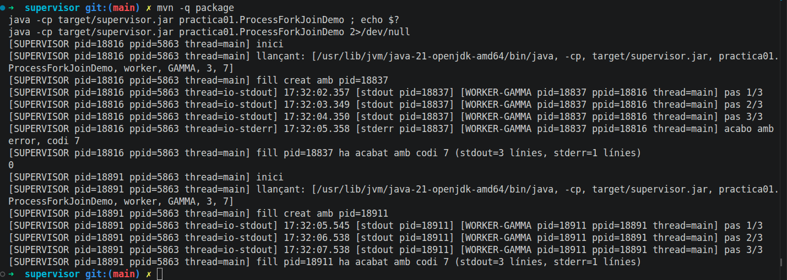

### Conclusiones

- Cada línea reemitida identifica **dos procesos**: quién la ha leído
  (`SUPERVISOR pid=18816`, hilo `io-stdout` o `io-stderr`) y quién la ha
  escrito (`WORKER-GAMMA pid=18837 ppid=18816`), con la hora y el tubo de
  origen.
- `main`, `io-stdout` e `io-stderr` son **hilos** del mismo proceso supervisor
  (mismo `pid=18816`). El worker es otro **proceso** (pid 18837, PPID 18816).
  Es la base de la actividad A.
- Con `2>/dev/null` desaparece la línea reemitida por `io-stderr`: el
  supervisor reemite las líneas de stderr del hijo por su propio stderr. El
  contador sigue diciendo `stderr=1 línies` porque la línea sí se ha
  capturado.
- El código 7 del worker llega al supervisor. El supervisor de momento
  termina con 0; más adelante su código reflejará los errores de los hijos.

## Paso 6a · Rol CONSUMER: lectura de stdin hasta EOF

El consumer lee stdin línea a línea hasta que `readLine()` devuelve `null`
(EOF), cuenta líneas y caracteres y escribe `COUNT=<n> CHARS=<n>` por stdout.
Sus diagnósticos van por stderr (`Log.diagnostico`).

### Prueba 1: entrada desde el teclado

    $ java -cp target/supervisor.jar practica01.ProcessForkJoinDemo consumer ; echo $?
    [CONSUMER pid=7884 ppid=4861 thread=main] esperant dades per stdin
    ana
    pep
                                  ← línea vacía (Intro de más)
    [CONSUMER pid=7884 ppid=4861 thread=main] EOF rebut       ← tras Ctrl+D
    COUNT=3 CHARS=6
    0

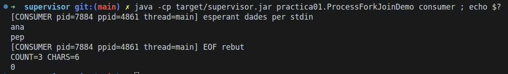

Las líneas `ana` y `pep` son el eco del teclado en la terminal, no salida del
programa. Sale `COUNT=3` porque se pulsó Intro una vez de más: una línea vacía
también es una línea (0 caracteres). Ctrl+D envía el EOF; sin él, el consumer
se queda esperando indefinidamente.

### Prueba 2: entrada desde otro programa (pipe de la shell, solo para probar)

    $ printf 'Ana\nJoan\nPep\nMarc\nLaia\n' | java -cp target/supervisor.jar practica01.ProcessForkJoinDemo consumer
    [CONSUMER pid=9219 ppid=4861 thread=main] esperant dades per stdin
    [CONSUMER pid=9219 ppid=4861 thread=main] EOF rebut
    COUNT=5 CHARS=18

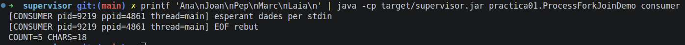

CHARS = 3 (Ana) + 4 (Joan) + 3 (Pep) + 4 (Marc) + 4 (Laia) = 18. Los saltos de
línea no se cuentan porque `readLine()` los elimina. El EOF llega solo: cuando
`printf` termina, su extremo del tubo se cierra.

### Prueba 3: solo stdout

    $ printf 'Ana\nJoan\nPep\nMarc\nLaia\n' | java -cp target/supervisor.jar practica01.ProcessForkJoinDemo consumer 2>/dev/null
    COUNT=5 CHARS=18

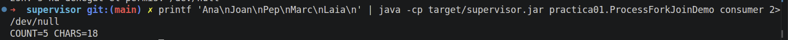

Al descartar stderr queda **solo el resultado**: el stdout del consumer
contiene únicamente datos, que es lo que leerá el supervisor.

## Paso 6b · Rol PRODUCER

El producer escribe cinco nombres por stdout (datos) y su diagnóstico por
stderr.

    $ java -cp target/supervisor.jar practica01.ProcessForkJoinDemo producer ; echo $?
    [PRODUCER pid=16448 ppid=4861 thread=main] generant 5 noms
    Ana
    Joan
    Pep
    Marc
    Laia
    0

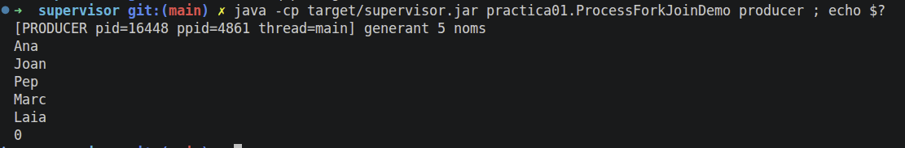

    $ java -cp target/supervisor.jar practica01.ProcessForkJoinDemo producer 2>/dev/null
    Ana
    Joan
    Pep
    Marc
    Laia

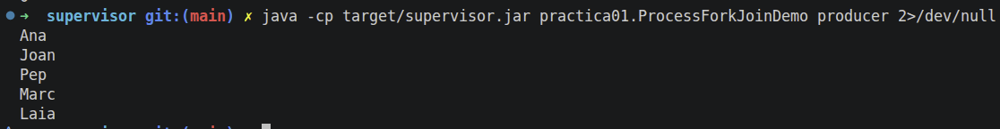

Prueba de compatibilidad producer → consumer con la pipe **de la shell**
(solo para comprobar que los roles encajan; en la solución la conexión la hace
el supervisor):

    $ java ... producer | java ... consumer
    [PRODUCER pid=17400 ppid=4861 thread=main] generant 5 noms
    [CONSUMER pid=17401 ppid=4861 thread=main] esperant dades per stdin
    [CONSUMER pid=17401 ppid=4861 thread=main] EOF rebut
    COUNT=5 CHARS=18

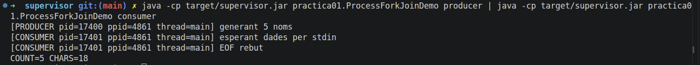

### Conclusiones

- La línea `[PRODUCER ...] generant 5 noms` no se cuenta como nombre porque va
  por **stderr**, y la pipe `|` solo conecta el **stdout** del producer con el
  stdin del consumer. Los stderr de los dos procesos siguen yendo a la
  terminal.
- Producer y consumer tienen **el mismo padre** (PPID 4861, la `zsh`): es la
  shell quien crea los dos procesos y el tubo que los une. Son procesos
  hermanos. En el paso 9 el padre de los dos será el supervisor, y será él
  quien pase los datos de uno a otro.
- El consumer recibe EOF sin Ctrl+D: cuando el producer termina, su stdout se
  cierra.

## Paso 6c · El supervisor envía datos por stdin y cierra el flujo

`Supervisor.ejecutar(orden, entrada)` lanza un hijo, arranca los dos lectores,
escribe las líneas de `entrada` en el stdin del hijo
(`Process.getOutputStream()`) y lo **cierra** (try-with-resources), de modo
que el hijo recibe EOF. Se ejecuta un worker (entrada vacía) y después el
consumer con cinco nombres.

    $ java -cp target/supervisor.jar practica01.ProcessForkJoinDemo ; echo $?
    [SUPERVISOR pid=25145 ppid=4861 thread=main] inici
    [SUPERVISOR pid=25145 ppid=4861 thread=main] llançant: [..., worker, GAMMA, 3, 7]
    [SUPERVISOR pid=25145 ppid=4861 thread=main] fill creat amb pid=25165
    [SUPERVISOR pid=25145 ppid=4861 thread=main] stdin del fill 25165 tancat (EOF enviat, 0 línies)
    [SUPERVISOR pid=25145 ppid=4861 thread=io-stdout] 10:06:21.829 [stdout pid=25165] [WORKER-GAMMA pid=25165 ppid=25145 thread=main] pas 1/3
    ...
    [SUPERVISOR pid=25145 ppid=4861 thread=io-stderr] 10:06:24.822 [stderr pid=25165] [WORKER-GAMMA pid=25165 ppid=25145 thread=main] acabo amb error, codi 7
    [SUPERVISOR pid=25145 ppid=4861 thread=main] fill pid=25165 ha acabat amb codi 7 (stdout=3 línies, stderr=1 línies)
    [SUPERVISOR pid=25145 ppid=4861 thread=main] llançant: [..., consumer]
    [SUPERVISOR pid=25145 ppid=4861 thread=main] fill creat amb pid=25226
    [SUPERVISOR pid=25145 ppid=4861 thread=main] stdin del fill 25226 tancat (EOF enviat, 5 línies)
    [SUPERVISOR pid=25145 ppid=4861 thread=io-stderr] 10:06:25.019 [stderr pid=25226] [CONSUMER pid=25226 ppid=25145 thread=main] esperant dades per stdin
    [SUPERVISOR pid=25145 ppid=4861 thread=io-stderr] 10:06:25.020 [stderr pid=25226] [CONSUMER pid=25226 ppid=25145 thread=main] EOF rebut
    [SUPERVISOR pid=25145 ppid=4861 thread=io-stdout] 10:06:25.028 [stdout pid=25226] COUNT=5 CHARS=18
    [SUPERVISOR pid=25145 ppid=4861 thread=main] fill pid=25226 ha acabat amb codi 0 (stdout=1 línies, stderr=2 línies)
    [SUPERVISOR pid=25145 ppid=4861 thread=main] fi
    0

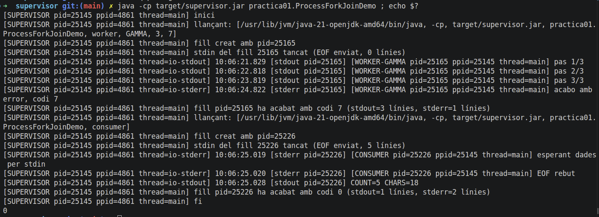

### Conclusiones

- El consumer tiene **PPID 25145**: ahora su padre es el supervisor, no la
  shell.
- Los nombres viajan **hacia** el consumer (supervisor → stdin del hijo, desde
  el hilo `main`). El hilo `io-stdout` lee lo que el consumer **devuelve**:
  solo `COUNT=5 CHARS=18`. El hilo `io-stderr` lee sus dos diagnósticos.
- El mensaje `stdin ... tancat (5 línies)` aparece **antes** de que el consumer
  diga `esperant dades per stdin`: el supervisor escribe en el tubo cuando la
  JVM del consumer todavía está arrancando. Los datos esperan en el búfer del
  tubo hasta que el consumer los lee.
- Al worker se le cierra el stdin sin escribir nada (0 líneas): no lee stdin,
  así que no le afecta.
- Si no se cerrara el stdin, el consumer no recibiría nunca el EOF: se
  quedaría en `readLine()` para siempre y el supervisor en `waitFor()`, es
  decir, los dos colgados.

## Paso 7 · Resultado inmutable

`Supervisor.ejecutar()` devuelve un `Resultado` (record inmutable) con orden,
PID, PPID, código, timeout, duración y las líneas de stdout y stderr. El
supervisor recoge todos los resultados y termina con **1 si alguno ha
fallado** (código ≠ 0 o timeout).

    $ java -cp target/supervisor.jar practica01.ProcessForkJoinDemo ; echo $?
    ...
    [SUPERVISOR pid=12107 ppid=8496 thread=main] resultat: pid=12129 ppid=12107 codi=7 timeout=no durada=3088ms stdout=3 línies stderr=1 línies ordre=[practica01.ProcessForkJoinDemo, worker, GAMMA, 3, 7]
    ...
    [SUPERVISOR pid=12107 ppid=8496 thread=main] resultat: pid=12204 ppid=12107 codi=0 timeout=no durada=69ms stdout=1 línies stderr=2 línies ordre=[practica01.ProcessForkJoinDemo, consumer]
    [SUPERVISOR pid=12107 ppid=8496 thread=main] FALLADA: pid=12129 ppid=12107 codi=7 timeout=no durada=3088ms ...
    [SUPERVISOR pid=12107 ppid=8496 thread=main] fi: 2 processos, 1 fallits
    1

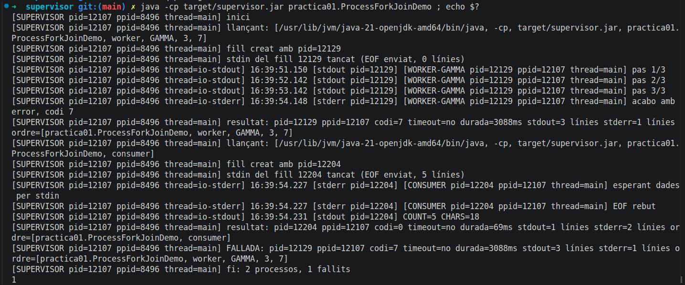

### Conclusiones

- Duración del worker GAMMA: **3088 ms** = 3 pasos × 1 s de `sleep` + ~90 ms
  de arranque de la JVM del hijo.
- Duración del consumer: **69 ms**: no tiene pausas; solo arranca, lee cinco
  líneas y responde.
- **Actividad B**: el worker acaba con código 7, el supervisor **continúa**
  con el siguiente hijo (el consumer se ejecuta igualmente), marca el error
  como `FALLADA` por stderr y termina con código **1**, de modo que el error
  queda explícito también para la shell (o para systemd).

## Paso 8a · Timeout (actividad D)

Cada hijo tiene un límite de 5 s (`waitFor(limite)`). Si se pasa, el
supervisor llama a `aturar()`: primero `destroy()` (SIGTERM, finalización
ordenada) al hijo y sus descendientes; si al cabo de 2 s de gracia sigue
vivo, `destroyForcibly()` (SIGKILL, finalización forzada).

Escenario: ALPHA (2 pasos, código 0), BETA (10 pasos: supera el límite),
GAMMA (3 pasos, código 7) y el consumer.

    [SUPERVISOR pid=22526 ppid=8496 thread=main] resultat: pid=22546 ppid=22526 codi=0 timeout=no durada=2082ms stdout=2 línies stderr=0 línies ordre=[..., worker, ALPHA, 2, 0]
    ...
    [SUPERVISOR pid=22526 ppid=8496 thread=io-stdout] 16:58:29.675 [stdout pid=22596] [WORKER-BETA pid=22596 ppid=22526 thread=main] pas 5/10
    [SUPERVISOR pid=22526 ppid=8496 thread=main] TIMEOUT: el fill 22596 supera 5000ms
    [SUPERVISOR pid=22526 ppid=8496 thread=main] fill 22596 aturat de forma ordenada
    [SUPERVISOR pid=22526 ppid=8496 thread=main] resultat: pid=22596 ppid=22526 codi=143 timeout=sí durada=5026ms stdout=5 línies stderr=0 línies ordre=[..., worker, BETA, 10, 0]
    ...
    [SUPERVISOR pid=22526 ppid=8496 thread=main] resultat: pid=22662 ppid=22526 codi=7 timeout=no durada=3074ms ...
    [SUPERVISOR pid=22526 ppid=8496 thread=main] resultat: pid=22713 ppid=22526 codi=0 timeout=no durada=68ms ... consumer
    [SUPERVISOR pid=22526 ppid=8496 thread=main] FALLADA: pid=22596 ... codi=143 timeout=sí ...
    [SUPERVISOR pid=22526 ppid=8496 thread=main] FALLADA: pid=22662 ... codi=7 timeout=no ...
    [SUPERVISOR pid=22526 ppid=8496 thread=main] fi: 4 processos, 2 fallits
    1

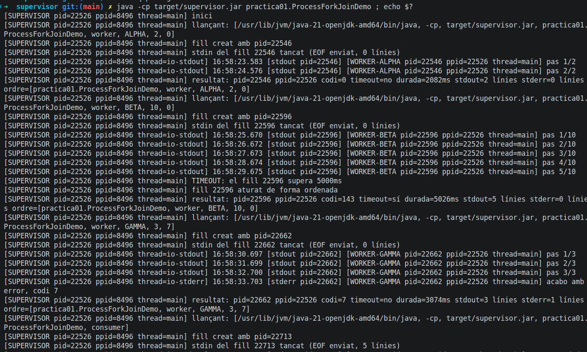
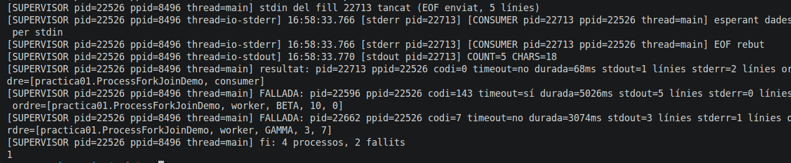

Comprobación con `ps` desde otra terminal de que BETA no queda vivo (la única
línea es el propio `grep`):

    $ ps -eo pid,ppid,stat,cmd | grep "worker BETA"
      24478    8498 S+   grep --color=auto ... worker BETA

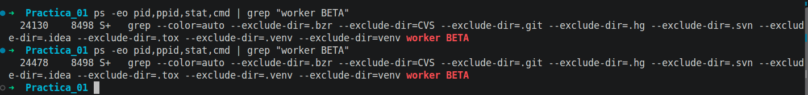

### Secuencia de finalización

| Momento | Qué pasa |
|---|---|
| 16:58:24.6 | Se lanza BETA (pid 22596) |
| 16:58:25.6 → 29.6 | Pasos 1/10 a 5/10 (uno por segundo) |
| ~16:58:29.6 | `waitFor(5000 ms)` devuelve `false` → `TIMEOUT` |
| inmediatamente | `destroy()` → SIGTERM. La JVM del worker termina de forma ordenada |
| | `waitFor(2 s de gracia)` devuelve `true` → no hace falta SIGKILL |
| | Código **143 = 128 + 15 (SIGTERM)**; duración 5026 ms |

### Conclusiones

- BETA se para entre el paso 5 y el 6: el límite son 5 s y cada paso dura 1 s.
- La finalización ha sido **ordenada**: el worker ha respondido a SIGTERM
  dentro del tiempo de gracia, así que no ha hecho falta `destroyForcibly()`.
- El código 143 demuestra que el proceso ha terminado por la señal 15.
- Un timeout cuenta como fallo (`exito()` es `false`): el supervisor sigue con
  GAMMA y el consumer, informa de dos `FALLADA` y termina con código 1.
- `ps` confirma que no queda ningún proceso `worker BETA` vivo.
