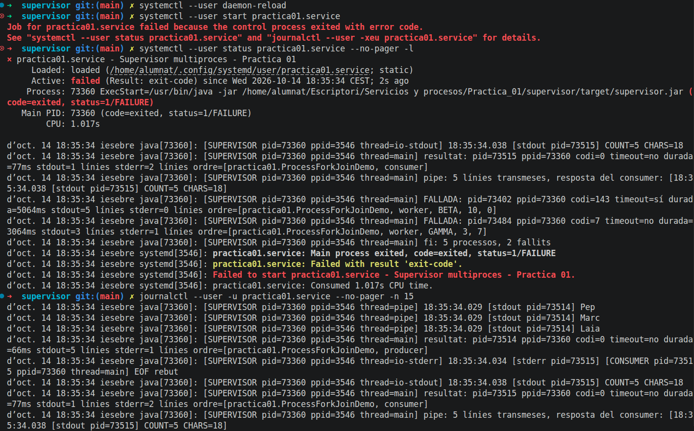
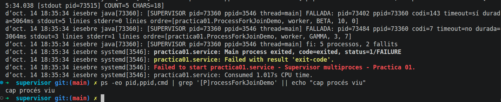
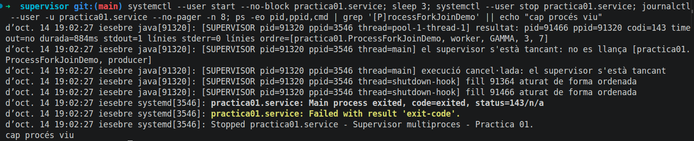
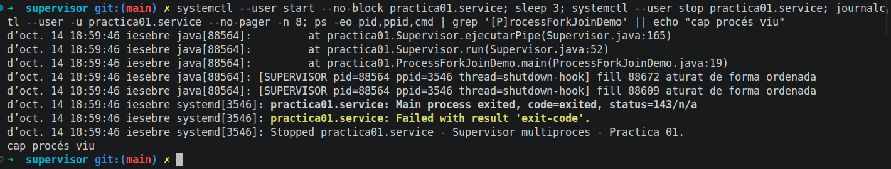

# Ampliación · Supervisor como servicio systemd

## Entorno

- Linux con systemd. El usuario `alumnat` **no tiene sudo** (pide contraseña),
  así que se usa una **unidad de usuario** (`systemctl --user`): el servicio
  se ejecuta con la cuenta del alumno, sin privilegios, tal como pide el
  enunciado.
- La unidad **no se habilita** (no tiene sección `[Install]`): no puede
  arrancar sola al iniciar el ordenador. `systemctl --user is-enabled`
  devuelve `static`.

## Fichero `systemd/practica01.service`

    [Unit]
    Description=Supervisor multiproces - Practica 01

    [Service]
    Type=oneshot
    WorkingDirectory=/home/alumnat/Escriptori/Servicios y procesos/Practica_01/supervisor
    ExecStart=/usr/bin/java -jar "/home/alumnat/Escriptori/Servicios y procesos/Practica_01/supervisor/target/supervisor.jar"
    TimeoutStartSec=90s
    KillMode=control-group
    StandardOutput=journal
    StandardError=journal

Diferencias con el ejemplo del enunciado: no hay `User=` (en una unidad de
usuario el servicio ya se ejecuta con la cuenta del usuario) y la ruta del
`.jar` va entre comillas porque contiene espacios.

| Directiva | Por qué |
|---|---|
| `Type=oneshot` | El supervisor hace una tarea finita y termina. systemd espera a que acabe y registra su código. |
| `TimeoutStartSec=90s` | Mayor que el límite interno de cada hijo (5 s) más la gracia (2 s) y la pipe: systemd no corta nunca una ejecución normal (~6 s). |
| `KillMode=control-group` | Si se para el servicio, systemd envía la señal a **todos** los procesos del grupo de control (supervisor y workers). |
| `StandardOutput/Error=journal` | Las líneas que el supervisor reemite (con rol y PID) quedan en el journal. |

## Órdenes

    # Instalación (sin habilitar)
    mkdir -p ~/.config/systemd/user
    cp systemd/practica01.service ~/.config/systemd/user/
    systemctl --user daemon-reload

    # Ejecución y consulta
    systemctl --user start practica01.service
    systemctl --user status practica01.service --no-pager
    journalctl --user -u practica01.service --no-pager
    ps -eo pid,ppid,cmd | grep '[P]rocessForkJoinDemo'

    # Parada a medias
    systemctl --user start --no-block practica01.service
    systemctl --user stop practica01.service

Equivalente con una unidad de sistema (si hubiera permisos):
`sudo cp ... /etc/systemd/system/`, `sudo systemctl daemon-reload`,
`sudo systemctl start practica01.service`, `sudo journalctl -u practica01.service`,
y entonces sí con `User=alumnat`.

## Resultado de la ejecución normal

    $ systemctl --user daemon-reload
    $ systemctl --user start practica01.service
    Job for practica01.service failed because the control process exited with error code.
    $ systemctl --user status practica01.service --no-pager -l
    × practica01.service - Supervisor multiproces - Practica 01
         Loaded: loaded (/home/alumnat/.config/systemd/user/practica01.service; static)
         Active: failed (Result: exit-code) since Wed 2026-10-14 18:35:34 CEST; 2s ago
        Process: 73360 ExecStart=/usr/bin/java -jar .../target/supervisor.jar (code=exited, status=1/FAILURE)
       Main PID: 73360 (code=exited, status=1/FAILURE)
    ...
    $ journalctl --user -u practica01.service --no-pager -n 15
    ... java[73360]: [SUPERVISOR pid=73360 ppid=3546 thread=pipe] 18:35:34.029 [stdout pid=73514] Laia
    ... java[73360]: [SUPERVISOR pid=73360 ppid=3546 thread=io-stdout] 18:35:34.038 [stdout pid=73515] COUNT=5 CHARS=18
    ... java[73360]: [SUPERVISOR pid=73360 ppid=3546 thread=main] FALLADA: pid=73402 ppid=73360 codi=143 timeout=sí ... worker, BETA, 10, 0]
    ... java[73360]: [SUPERVISOR pid=73360 ppid=3546 thread=main] FALLADA: pid=73484 ppid=73360 codi=7 timeout=no ... worker, GAMMA, 3, 7]
    ... java[73360]: [SUPERVISOR pid=73360 ppid=3546 thread=main] fi: 5 processos, 2 fallits
    ... systemd[3546]: practica01.service: Main process exited, code=exited, status=1/FAILURE
    ... systemd[3546]: practica01.service: Failed with result 'exit-code'.
    $ ps -eo pid,ppid,cmd | grep '[P]rocessForkJoinDemo' || echo "cap procés viu"
    cap procés viu

- El PPID del supervisor es **3546**: el gestor `systemd --user` (las líneas
  `systemd[3546]` del journal), no una shell. Los hijos tienen PPID 73360, el
  supervisor.
- El journal contiene las líneas que el supervisor reemite, identificadas con
  rol, PID y PPID, incluidas las de la pipe (`thread=pipe`) y la respuesta
  `COUNT=5 CHARS=18`.
- El servicio queda en `failed` con `status=1` porque la demo incluye dos
  hijos que fallan **a propósito** (BETA por timeout y GAMMA con código 7). Es
  el resultado esperado: el supervisor informa del fallo con su código de
  retorno y systemd lo refleja. Si todos los hijos acabaran bien, sería
  `status=0/SUCCESS` e `inactive (dead)`.
- Después de la ejecución, `ps` no encuentra ningún proceso de la práctica.

## Resultado de la parada a medias

    $ systemctl --user start --no-block practica01.service; sleep 3; systemctl --user stop practica01.service; journalctl --user -u practica01.service --no-pager -n 8; ps -eo pid,ppid,cmd | grep '[P]rocessForkJoinDemo' || echo "cap procés viu"

Salida (después de la corrección de la incidencia):

    [SUPERVISOR pid=89477 ppid=3546 thread=main] el supervisor s'està tancant: no es llança [practica01.ProcessForkJoinDemo, producer]
    [SUPERVISOR pid=89477 ppid=3546 thread=main] execució cancel·lada: el supervisor s'està tancant
    [SUPERVISOR pid=89477 ppid=3546 thread=shutdown-hook] fill 89554 aturat de forma ordenada
    [SUPERVISOR pid=89477 ppid=3546 thread=shutdown-hook] fill 89503 aturat de forma ordenada
    practica01.service: Main process exited, code=exited, status=143/n/a
    practica01.service: Failed with result 'exit-code'.
    Stopped practica01.service - Supervisor multiproces - Practica 01.
    cap procés viu

- `systemctl stop` envía SIGTERM a todo el grupo de control
  (`KillMode=control-group`): supervisor y workers.
- El shutdown hook del supervisor marca el cierre y para a los hijos
  activos de forma ordenada.
- El hilo `main` ya no lanza la pipe: `lanzar()` lo rechaza porque el
  supervisor se está cerrando, y `run()` termina con `execució cancel·lada`.
- Código 143 (SIGTERM) y **ningún proceso vivo** después de la parada.

Antes de la corrección, la misma prueba ya no dejaba procesos vivos, pero
mostraba una traza de excepción (ver [Incidencias](Incidencias.md)):

## ¿Por qué `Type=oneshot` y no un servicio residente?

- **oneshot**: el supervisor recibe un trabajo finito (tres workers y una
  pipe), lo ejecuta y termina. systemd considera el servicio "activándose"
  mientras trabaja y, cuando acaba, registra el código de salida. Es lo que
  corresponde a esta práctica.
- **Residente** (`Type=simple`/`notify`, normalmente con `Restart=`): el
  proceso se queda vivo indefinidamente esperando trabajo (una cola, un
  socket, un directorio…). Necesitaría una fuente continua de tareas y un
  bucle principal que no acaba, y systemd lo reiniciaría si muriera. Con el
  supervisor actual no tendría sentido: acabaría enseguida y systemd lo
  vería como un fallo o lo reiniciaría en bucle.
- El supervisor no se "daemoniza" (no hace fork y deja el padre): se queda en
  primer plano, de modo que los workers son descendientes del proceso
  principal del servicio y están dentro de su grupo de control.
